# Weihnachtszeit in Britz

Eine interaktive Chronik der Advents- und Weihnachtszeit in Britz und dem Amt Britz-Chorin-Oderberg, 2009–2026 — Adventsfeste, Weihnachtsmärkte, Konzerte, Seniorenfeiern und Traditionen.

> [https://seekwhencer.github.io/britz-chorin-oderberg-weihnachts-chronik/](https://seekwhencer.github.io/britz-chorin-oderberg-weihnachts-chronik/)

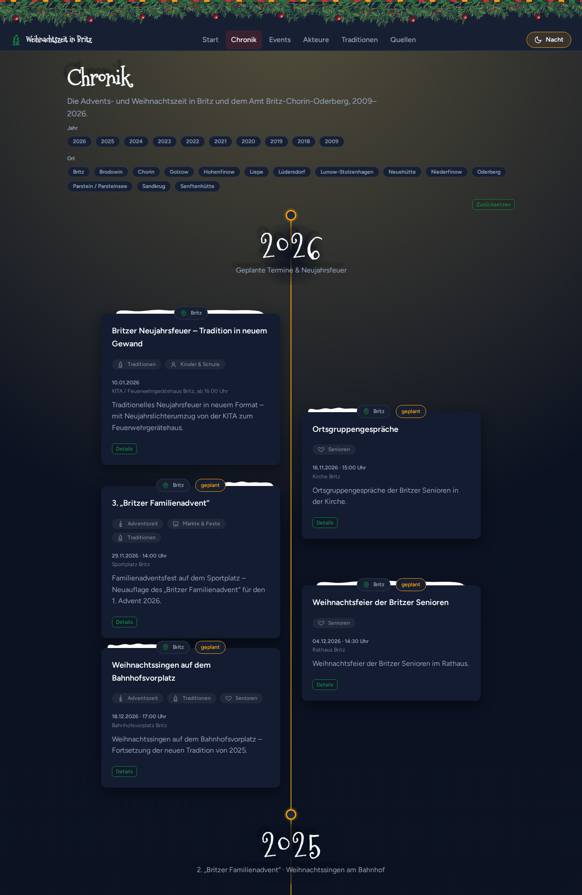

Statische Single-Page-App ohne Build-Step und ohne Frameworks: Vanilla-JS (ES-Modules, Klassen), nummerierte CSS-Partials, Daten als JSON. Lauffähig auf GitHub Pages oder jedem statischen Host.

## Features

- **Start** (`#/`) — Hero, Countdown zum nächsten Termin, Highlights
- **Chronik** (`#/chronik`) — Zeitstrahl 2009–2026, Jahre als Meilensteine
- **Events** (`#/events`) — filterbare Galerie (Jahr, Kategorie, Veranstalter) + Live-Suche
- **Akteure** (`#/akteure`) — Organisationen & Personen mit ihren Events
- **Traditionen** (`#/traditionen`) — wiederkehrende Bräuche (Ortsweihnachtsbaum, Familienadvent, …)
- **Quellen** (`#/quellen`) — Quellen, Methodik, Stand
- Nacht-/Tag-Theme, Schneefall, Lichterkette, Scroll-Reveal — jeweils mit `prefers-reduced-motion`-Fallback
- Hash-Routing (teilbare URLs, funktioniert ohne Server-Rewrites)

## Loslegen

```bash
npm install
npm run dev        # http://localhost:2412 (node --watch)
# oder
npm start          # http://localhost:2412
```

- Health-Check: `GET /health`
- Port über `PORT`-Umgebungsvariable änderbar (Default `2412`)
- Alternativ: jeder statische Server in `public/` (z. B. `python3 -m http.server` in `public/`)

## Screenshots

Alle Screenshots liegen in `.docs/screenshots/` und werden mit `cd .docs && npm run screenshots` neu erzeugt (Tag und Nacht).

| Tag (Light) | Nacht (Dark) |
|-------------|--------------|
| 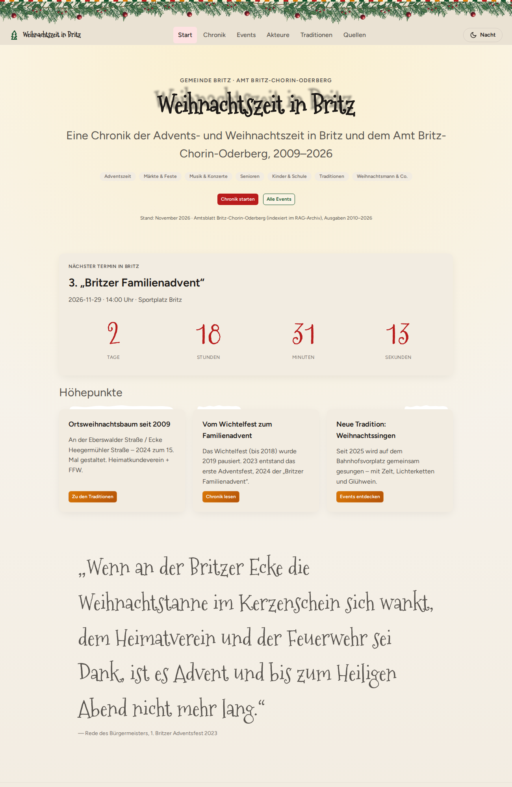 | 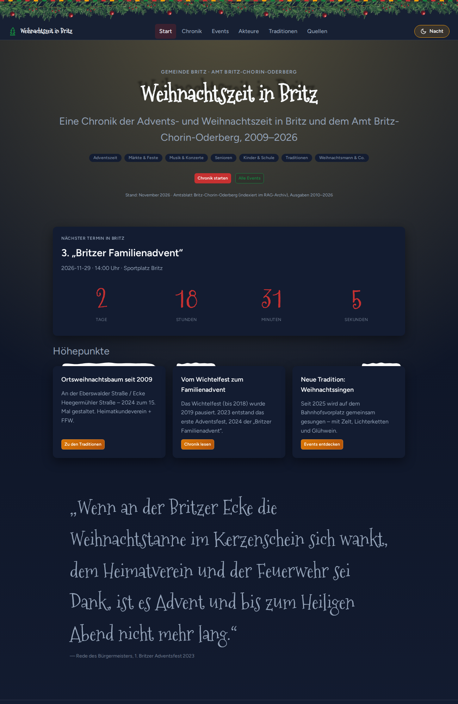 |
| 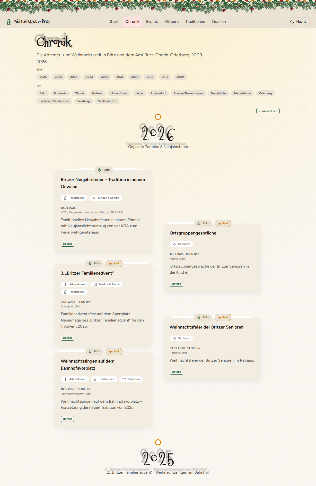 |  |
| 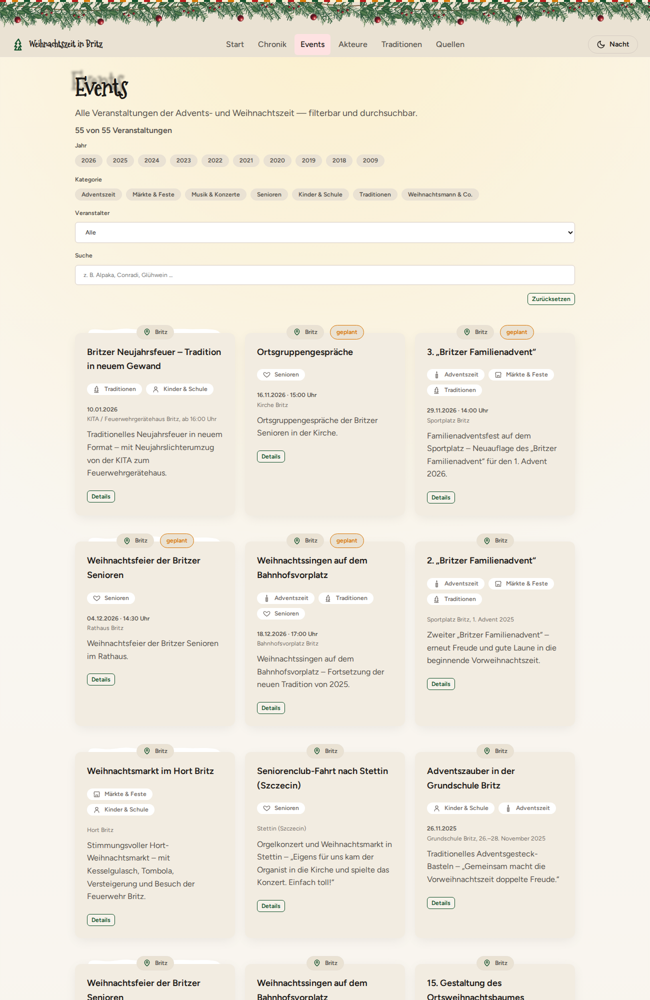 | 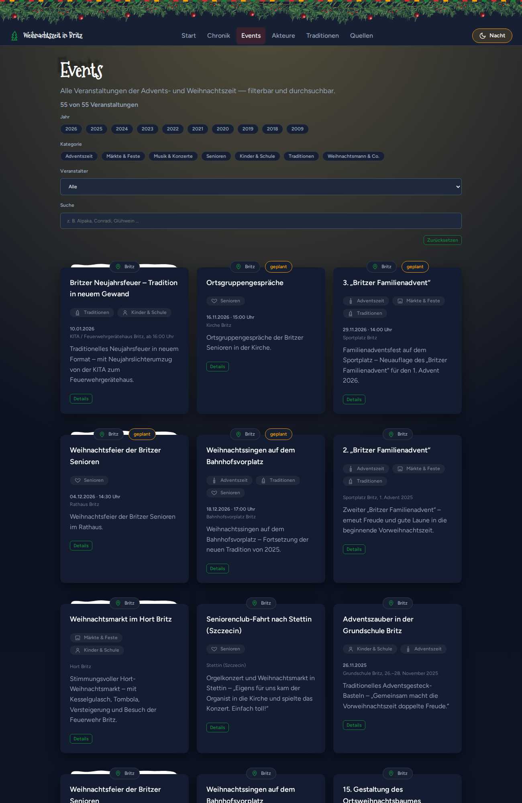 |
| 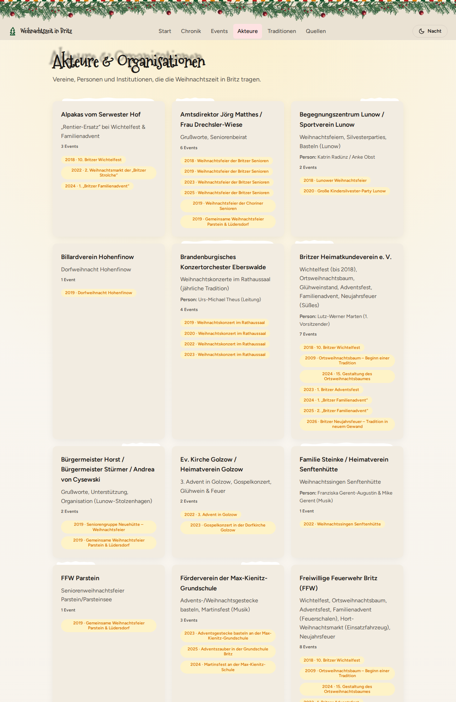 | 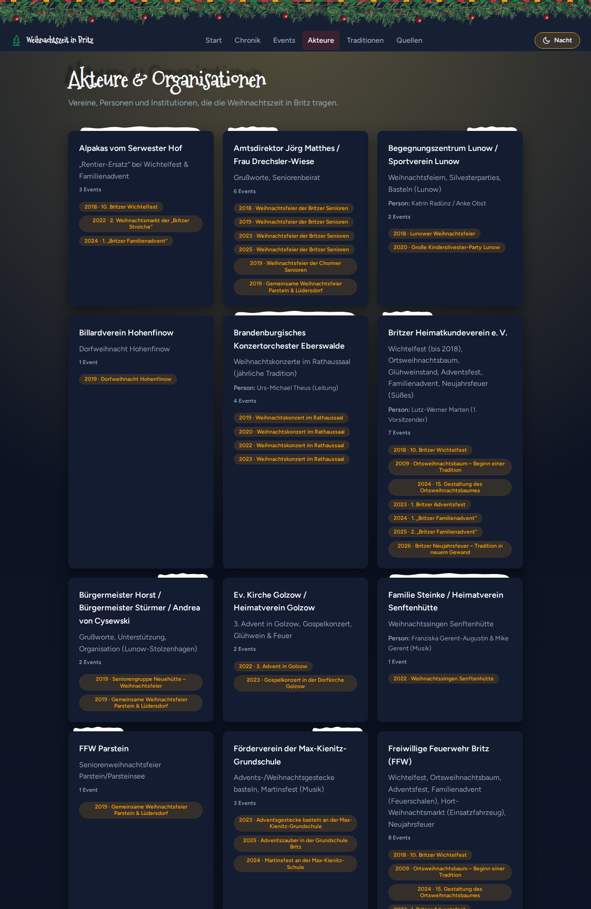 |
| 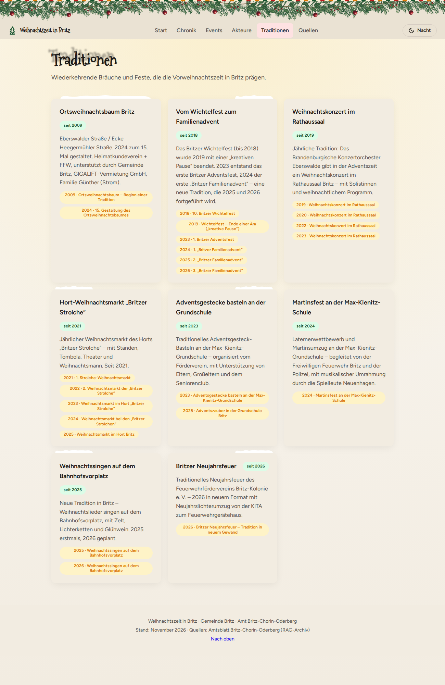 | 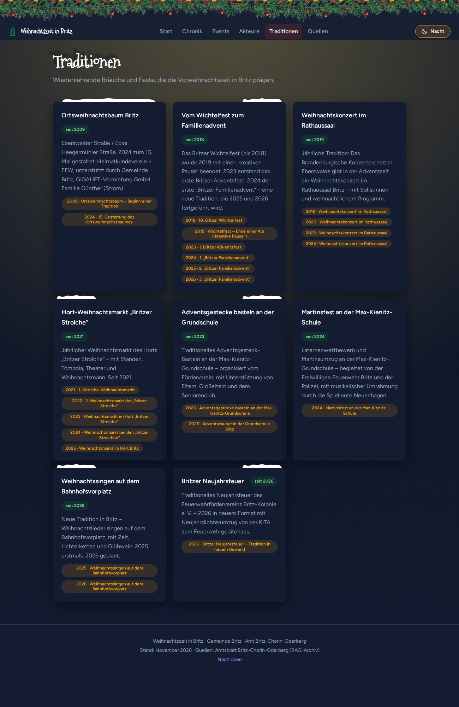 |
| 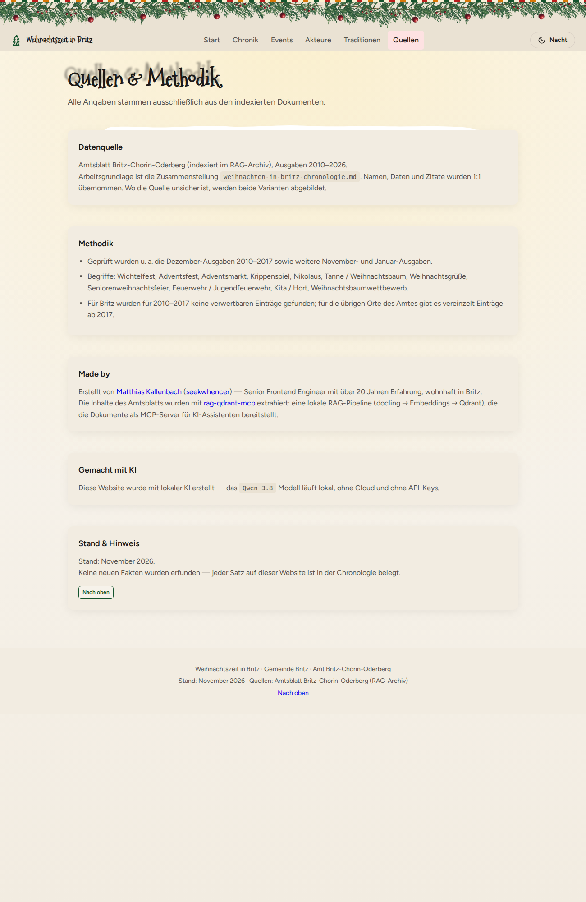 | 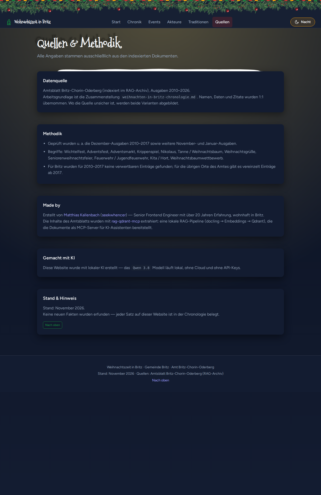 |

## Lizenz

Inhalte: Gemeinde Britz · Amt Britz-Chorin-Oderberg (Quellen: Amtsblatt, RAG-Archiv).

## KI-Hinweis

- Gemacht mit lokaler KI
